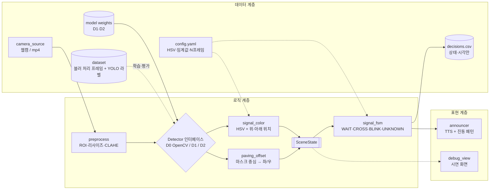

# Week 07 팀 활동지 / Team Activity

> 팀 초안(AI 보조 작성, PROMPTS.md 기록). 검토 후 수정하세요. 모듈 경로는 저장소 구조에 맞춰 `walkaid/` 아래로 옮겼습니다.

| 팀명 / Team | 작성일 / Date | 참여자 / Members |
|---|---|---|
| 굳건 | 2026-10-__ | 박재원, 박지성, 강태혁, 전시준 |

### 1. 아키텍처 다이어그램 / Architecture Diagram


> 손그림은 아래 흐름을 옮겨 그리면 됩니다. 실선은 실행 중 데이터 흐름, 점선은 개발·평가 때만 쓰는 흐름입니다.



| 계층 / Layer | 모듈·파일 / Modules | 의존하지 않는 것 / Does not depend on |
|---|---|---|
| 표현 / Presentation | `walkaid/present/announcer.py` (상태별 음성 문구와 진동 패턴, 상태가 바뀔 때만 안내), `walkaid/present/debug_view.py` (검출 박스, 신호 색, 현재 상태를 겹쳐 보여주는 시연 화면) | 검출 방법(D0·D1·D2), HSV 값, 입력이 웹캠인지 파일인지 |
| 로직 / Logic | `walkaid/logic/preprocess.py`, `walkaid/logic/detector/base.py` (Detector 인터페이스), `walkaid/logic/detector/opencv_rule.py`(D0), `walkaid/logic/detector/yolo.py`(D1·D2: 가중치 파일만 다름), `walkaid/logic/signal_color.py`, `walkaid/logic/paving_offset.py`, `walkaid/logic/scene_state.py`, `walkaid/logic/signal_fsm.py` | 안내 방식(음성·진동·화면), 카메라 장치, 라벨링 도구, 학습 방법 |
| 데이터 / Data | `walkaid/io/camera_source.py` (`frames()` 하나로 웹캠·mp4 제공), `models/*.pt`, `config.yaml`, `data/` (블러 처리 프레임, YOLO 라벨, `clips.csv`, 장소 단위 분할 목록), `logs/decisions.csv` (상태 변화와 시각만, 이미지 없음), `tools/` (블러, 프레임 추출, 분할, 평가 스크립트) | 상태 머신 규칙, 안내 문구 |

**SceneState 스키마 (모듈 사이 유일한 약속)**

```json
{
  "ts": 1730000000.12,
  "frame_ok": true,
  "signal": {"present": true, "color": "green", "conf": 0.91, "pos_check": true},
  "paving": {"present": true, "type": "line", "offset": "left", "conf": 0.78}
}
```

**설계 근거**: 가장 바뀔 결정은 검출 방법이라 `Detector` 뒤에 감췄습니다. D0 → D1 → D2로 바꿔도 `signal_fsm`과 `announcer`는 한 줄도 고치지 않습니다. 안전 규칙(상태 머신)은 검출 방법과 분리해서, 검출이 틀려도 "CROSS를 함부로 내지 않는" 성질이 유지되게 했습니다.

### 2. 이슈 / Issues

| # | 제목 / Title | 라벨 / Label | 담당 / Assignee | 완료 조건 / Acceptance Criteria |
|---|---|---|---|---|
| 예시 #3 | 알레르기 필터 | backend | 홍길동 | '땅콩'을 선택하면 땅콩이 들어간 메뉴가 추천 결과에서 빠진다 |
| #1 | Define SceneState schema & label classes | docs | 박재원 | `docs/scene-state.md`와 `docs/labeling-guide.md`(클래스 6개, 사례 사진 포함)가 있고, 팀원 3명이 PR에서 승인했다 |
| #2 | Camera/video source abstraction | data | 강태혁 | `frames()`가 웹캠과 mp4에서 같은 형식으로 프레임을 내고, 60초 영상을 끝까지 오류 없이 읽는다 |
| #3 | Capture protocol & field recording | data | 전시준 | 8곳 이상에서 찍은 클립 30개 이상이 있고, `clips.csv`에 장소·시간·날씨가 기록돼 있다 |
| #4 | Anonymize & extract frames | data | 강태혁 | `tools/blur.py`를 돌리면 샘플 50장에서 얼굴·번호판이 하나도 알아볼 수 없게 되고, 1fps로 프레임이 추출되며, 원본 영상 삭제가 확인된다 |
| #5 | OpenCV baseline detector (D0) | vision | 박지성 | 테스트 클립에서 보행 신호 색(빨강/초록/없음)을 판별한 결과와 혼동행렬이 `docs/eval.md`에 기록된다 (D0는 목표 수치 없이 기준선으로만 씀) |
| #6 | Signal color by HSV + position | vision | 박지성 | 신호등 박스를 넣으면 색과 위치가 어긋날 때 `unknown`을 반환하고, 단위 테스트 8케이스(역광·야간 포함)를 통과한다 |
| #7 | Signal state machine | logic | 박재원 | 테스트 클립 전체에서 **빨간불·점멸 중 CROSS 안내 0회**, 도착 시 이미 초록이면 CROSS를 내지 않으며, 프레임이 1초 이상 끊기면 UNKNOWN이 된다 |
| #8 | Audio & vibration announcer | output | 전시준 | 상태 5개가 서로 다른 문구로 상태 변화 후 1초 이내에 재생되고, 같은 상태는 반복 안내하지 않는다 |
| #9 | End-to-end walking skeleton | integration | 박재원 | `python -m walkaid.main --source clip.mp4 --detector d0` 한 줄로 영상 입력부터 음성 출력까지 실행된다 |
| #10 | Debug view for demo | presentation | 전시준 | 시연 화면에 검출 박스, 색, 현재 상태, fps가 실시간으로 보인다 |
| #11 | Label dataset & agreement check | data | 전원 | 라벨된 프레임 1,500장 이상, 장소 단위 분할 목록, 2인 교차 라벨 50장의 일치율이 `docs/labeling-report.md`에 있다 |
| #12 | Pretrained YOLO detector (D1) | vision | 강태혁 | `--detector d1`로 바꿔도 #9 명령이 그대로 동작하고, D0와 같은 테스트셋 결과가 `docs/eval.md`에 추가된다 |
| #13 | Fine-tuned YOLO (D2) | ml | 박지성 | 학습셋으로 학습한 모델이 테스트 장소 2곳에서 `ped_red`·`ped_green` 재현율 90% 이상, 색상 증강은 끈 설정 파일이 저장소에 있다 |
| #14 | Tactile paving offset (Should) | vision | 강태혁 | 점자블록이 화면 중심에서 벗어나면 left/right를 SceneState에 기록하고, 라벨된 테스트 프레임에서 방향을 85% 이상 맞힌다 |
| #15 | D0 vs D1 vs D2 evaluation | test | 박재원 | 같은 테스트셋으로 평가 지표 6개(정밀도·재현율, 혼동행렬, 빨간불·점멸 중 CROSS 횟수, 안내 지연, UNKNOWN 비율, fps)를 비교한 표와 해석 3줄이 `docs/eval.md`에 있다 |
| #16 | Run package & README | docs | 전시준 | 새 노트북에서 README만 보고 설치부터 샘플 영상 실행까지 15분 안에 된다(작성자가 아닌 팀원이 실제로 해봄) |

**작업 순서 (DAG → 위상 정렬)**

| 단계 | 동시 착수 가능 | 선행 이슈 |
|---|---|---|
| 1 | #1, #2, #3 | 없음 (#1은 공통 결정이라 맨 앞) |
| 2 | #4, #5, #6, #8 | #4←#3, #5←#1·#2, #6←#1, #8←#1 |
| 3 | #7, #11 | #7←#6, #11←#1·#4 |
| 4 | #9, #10, #12 | #9←#5·#7·#8, #10←#5, #12←#9 |
| 5 | #13, #14 | #13←#11·#12, #14←#11 |
| 6 | #15, #16 | #15←#5·#12·#13, #16←#9 |

> 라벨링(#11)은 시간이 가장 오래 걸리니 2단계부터 **병렬로** 굴립니다. 모델 학습(#13)이 라벨링에 막히지 않게 하기 위해서입니다.

### 3. 마일스톤 / Milestones

| 마일스톤 / Milestone | 마감 / Due | 포함 이슈 / Issues |
|---|---|---|
| MVP 완료 | 11주차 | #1~#10 — OpenCV 기준선(D0)과 상태 머신으로 "영상 → 신호 판단 → 음성"이 끝까지 동작. 비식별 처리된 데이터 수집 완료 |
| 실행 패키지 | 13주차 | #11~#16 — 라벨 데이터셋, 사전학습·미세조정 모델 비교, 점자블록 방향, 실행 문서 |

> MVP를 학습 없는 D0로 잡은 이유: 라벨링이 늦어져도 11주차 데모가 막히지 않게 하기 위해서입니다. 학습 모델은 **"D0보다 얼마나 나아졌나"**로 가치를 증명합니다.

> AI 사용 기록 → `PROMPTS.md`

---

